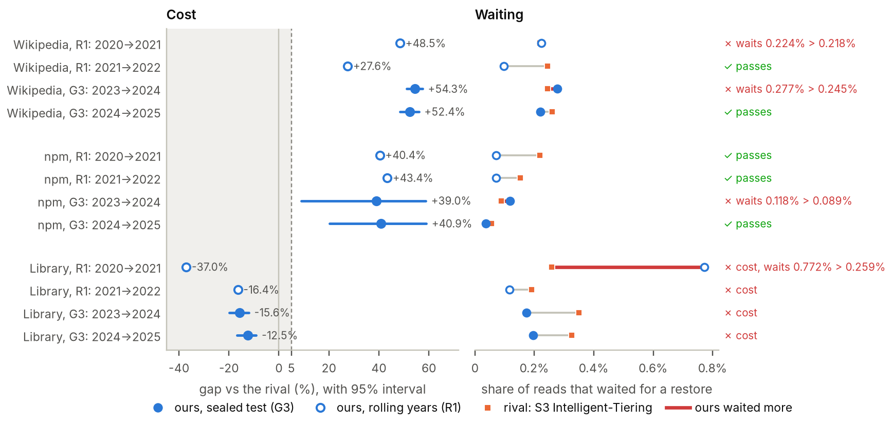

# Forecasting versus Reactive Cloud Auto-Tiering

**A pre-registered, fee-accurate test of one idea: can forecasting when archived files will be read beat today's reactive auto-tiering (S3 Intelligent-Tiering, Google Autoclass, Azure smart tier) on cost and on waiting time?**

**Answer: no.** By rules fixed before the data was seen, the idea fails.

📄 **Paper (PDF):** [Forecasting versus Reactive Cloud Auto-Tiering: A Pre-Registered, Fee-Accurate Test](paper/forecasting-vs-reactive-auto-tiering.pdf) (LaTeX source and figures in [paper/](paper/); submission notes in [paper/SUBMISSION.md](paper/SUBMISSION.md))
📊 **Every number:** [docs/RESULTS.md](docs/RESULTS.md) · **Rules, written first:** [docs/PREREGISTRATION.md](docs/PREREGISTRATION.md) · **Every decision:** [docs/DECISIONS.md](docs/DECISIONS.md)



*Every test year at "up to 1% of reads may wait", against S3 Intelligent-Tiering. Left: how much cheaper the per-file method was. Right: the share of reads that had to wait for a restore. A year passes only if it is at least 5% cheaper and waits no more. Wikipedia and npm failed in 2024 on waiting alone; the library data lost money every year.*

## Findings

- **Seasonal forecasting on its own never beat S3 Intelligent-Tiering.** Picked by the same rule, the seasonal-naive policy cost 0.6% to 29% more than the rival on every sealed line.
- **A per-file choice of policy was 39% to 54% cheaper** on Wikipedia and npm in the sealed years (2024 and 2025) when up to 1% of reads may wait. It saved by leaving a few large, rarely read files in Deep Archive behind restores of up to 48 hours. On Wikipedia, 2.4% of the files held 57% of the bytes and received 0.25% of the reads.
- **It still failed the pre-registered test.** In 2024, slightly more of its reads waited than the rival's: 0.277% against 0.245% on Wikipedia, 0.118% against 0.089% on npm. The same overshoot happened in the earlier rolling-year gate.
- **A reference that knew each file's true read rate passed every Wikipedia and npm line.** The per-file economics are real; predicting next year's reads from last year's is what fails.
- **Library demand kept shifting** (the 2020 closures, a 2024 ransomware attack on the library), and every method lost there. **On Azure, the method only tied smart tier.** **With no waiting allowed, nothing beat managed tiering.**
- **Reproduced:** a fresh clone of the frozen tag re-ran the sealed test and matched every number.

## How the test was run

| Step | What | Commit |
| --- | --- | --- |
| Simulator (gate G2) | Bills every file every day under AWS, Google and Azure rules; matched 24 of 24 hand calculations and the AWS Pricing Calculator; caught 48 of 48 planted bugs | Phase 3 |
| E1, early check | Seasonal-naive policies, picked on 2022, scored on 2023 | `d1cf04d` |
| R1, rolling years | Per-file chooser, 2020→2021 and 2021→2022. Failed narrowly; the owner overrode the stop rule as a documented deviation (D-051) | `0bde4de` |
| G3, sealed test | Pre-registered; 2023→2024 and 2024→2025; the code opened 2024-2025 only at the tag `freeze-g3`. **Failed** (D-052) | `cc4b852` |
| Paper | Figures from the committed results; typeset PDF | `120c921` |

## Use of AI

The research question is the author's, as are the decision to pre-register, every gate decision (including the override of R1) and the interpretation. The code, analyses, figures and drafts of the documents and paper were produced with the help of Claude (Anthropic), an AI model, working under the author's direction. Every decision is logged with its reason in [docs/DECISIONS.md](docs/DECISIONS.md), and the full history is in the git log.

## Cite

> Summit Khatiwada. *Forecasting versus Reactive Cloud Auto-Tiering: A Pre-Registered, Fee-Accurate Test.* Version 1.0, October 2026. https://github.com/summitkhatiwada22/seasonal-tiering-poc

See [CITATION.cff](CITATION.cff) (GitHub shows a "Cite this repository" button).

## How this project stays honest

- **Thresholds are fixed before the test.** Pass/fail rules were written down and tagged in git (`freeze-g3`) before the sealed test years were read ([docs/PREREGISTRATION.md](docs/PREREGISTRATION.md)). The code refuses to open 2024 and 2025 unless it runs at that tag. The test failed, and is reported as failed.
- **We compare against the strongest rival**, S3 Intelligent-Tiering and Google Autoclass, not a weak baseline.
- **Every price has a receipt.** Each number in `configs/prices/` carries a link to an official AWS, Azure or Google source and the rows read are copied in [docs/evidence/](docs/evidence/official-prices-2026-10-30.md). A test fails if any price is ever marked `unverified`.
- **We test the tester.** A synthetic generator plants known seasonal patterns and a no-season control, so we can tell a real win from a false one.
- **Every result is reproducible** from raw data with one command, at a tagged commit. Data is never committed; every downloaded file is recorded with a checksum in [data_records/manifests/](data_records/manifests/).
- **Stopping is allowed.** The final test failed, and the project stopped and wrote up why.

## Quick start

Requires [uv](https://docs.astral.sh/uv/) (it installs the right Python for you).

```bash
make setup     # install pinned dependencies
make check     # lint + type check + tests (what CI runs)
make synth     # generate a small synthetic dataset
make status    # which phase are we on?
make data      # points to the real-data commands (Phase 2 runbook)
make simulate  # smoke-test the cost and waiting-time simulator on synthetic data
make e1        # early check E1: tune on 2022, pick, score on 2023 (about an hour on 2 cores)
make paper     # rebuild the paper's figures and PDF (needs the local data and a LaTeX install)
```

The real datasets are downloaded to a folder outside the repository by following [docs/RUNBOOK_PHASE2.md](docs/RUNBOOK_PHASE2.md).

### Re-running the sealed test

The sealed years (2024 and 2025) open only for code at the tag `freeze-g3`. With the processed data in place (`data/processed`, or the folder named by `SAT_DATA`):

```bash
git fetch --tags && git checkout freeze-g3
uv run python -m sat.experiments.g3 run --workers 2        # about 3 hours on 2 cores, all 10 scenarios
uv run python -m sat.experiments.g3 score
uv run python -m sat.experiments.g3 reproduce --workers 2  # H9: fresh clone, base scenario, compare
```

## What is in the repo

| Path | What it holds |
| --- | --- |
| `paper/` | The paper: LaTeX source, bibliography, figures (PDF and PNG) and the built PDF; `make paper` rebuilds it |
| `scripts/paper/figures.py` | Draws every figure from the committed results |
| `docs/PROGRESS.md` | Phase tracker and stop points |
| `docs/DECISIONS.md` | Every choice that could change results, with the reason |
| `docs/data_cards/` | One card per dataset: source, licence, caveats |
| `docs/PHASE1_REPORT.md` to `docs/PHASE5_REPORT.md` | What each finished phase found |
| `docs/R1_PROTOCOL.md`, `docs/PREREGISTRATION.md`, `docs/RESULTS.md` | Round two's rules, the sealed test's pre-registration, and its results |
| `docs/SIM_RULES.md`, `docs/HAND_CALCS.md` | How prices become a bill (with official quotes) and the hand calculations the simulator must match |
| `docs/POLICIES.md`, `docs/E1_PROTOCOL.md` | Every storage policy compared, and the rules of early check E1 (fixed before the data was read) |
| `docs/RUNBOOK_PHASE2.md` | Commands to download and check the real data |
| `docs/evidence/` | Official price rows (text) and the owner's calculator screenshots |
| `configs/prices/` | AWS, Google and Azure price sheets with sources |
| `configs/datasets/` | Dataset sizes and seeds |
| `src/sat/synth/` | Synthetic data generator with ground truth |
| `src/sat/prices.py` | Price sheet loader and validator |
| `src/sat/ingest/` | Downloaders and checks for D1 to D5, checksums, quality report |
| `src/sat/sim/` | Cost and waiting-time simulator, including the billing of S3 Intelligent-Tiering and Autoclass |
| `src/sat/data/` | Loaders behind the sealed-year lock, demand-to-reads mapping, object sizes |
| `src/sat/policies/`, `src/sat/experiments/` | The policies (rivals, ours, references), the per-file chooser, and the E1, R1 and G3 runners |
| `reports/e1/`, `reports/r1/`, `reports/g3/` | Picks, verdicts and every run's cost and waits (CSV) for E1, R1 and the sealed test; `reports/g3/results.json` holds the G3 verdict |
| `scripts/` and `reports/` | Phase 1 and 2 source probes and their raw outputs; the planted-bug check (`mutation_check.py`) and speed check (`bench_sim.py`) |
| `tests/` | Automated tests |
| `data_records/` | Small records of the real data: checksums, article and package lists, flags, size summaries, quality report |
| `data/` | Local data and per-object experiment arrays, git-ignored |

## Licence

Code: [MIT](LICENSE). Paper, figures and documentation (`paper/`, `docs/`, `reports/`): [CC BY 4.0](LICENSE-docs.md). The datasets are not redistributed; each source's terms are in its [data card](docs/data_cards/). Licences chosen after the result was known, as planned (D-012, D-053).
